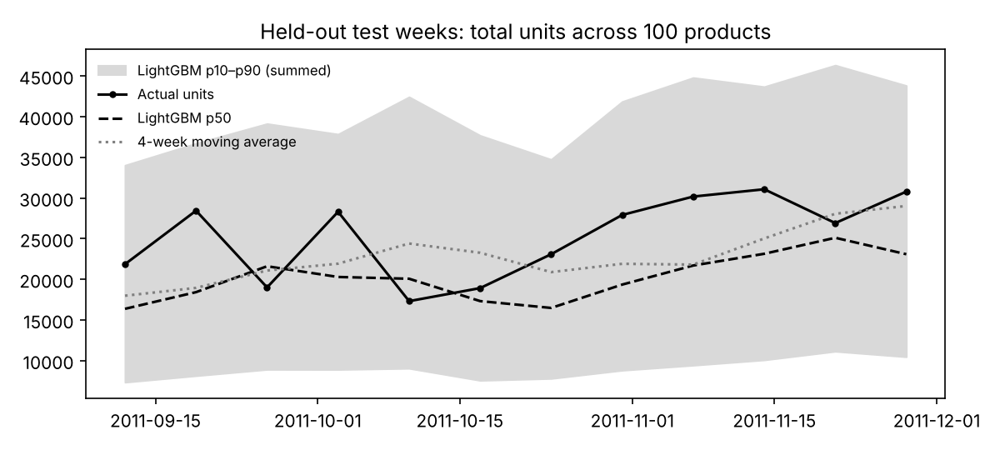
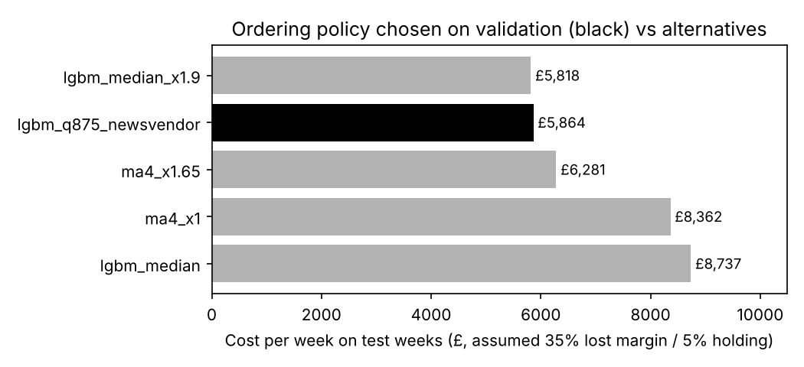
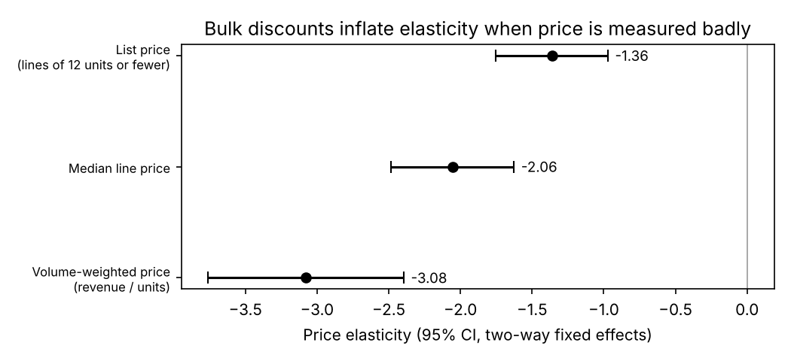

# Retail Demand Copilot

Demand forecasting, price elasticity and order decisions for the top 100 products of a real UK online gift retailer,
served as tools to an LLM planning agent that may only quote numbers the tools returned.

**What it shows**
- **Decision over accuracy.** LightGBM's median forecast is not clearly better than a 4-week moving average (WAPE 47.1% vs 49.5%; difference -2.41 pp, 95% CI -5.89 to 1.55). Ordering at the cost-optimal **0.875 quantile** is clearly better: **£2,499 per week cheaper** than ordering the moving average (95% CI £1,922–£3,166) and **£417 per week cheaper** than a moving average with a tuned safety stock (95% CI £136–£695).
- **Measurement bias in elasticity.** This retailer gives bulk discounts, so the average price paid falls when big orders arrive. Measured that way, elasticity looks like -3.077; with the list price it is **-1.362** (95% CI -1.752 to -0.971).
- **A guarded agent, measured.** Five tools behind FastAPI and a verifier that rejects any number not found in a tool result. On 40 questions, qwen2.5:7b
  answered **75%** of the answerable ones, refused **8 / 8** unanswerable ones and **never gave a wrong number**; the verifier ablation showed it caught nothing
  and cost 6 points of accuracy through false refusals.



## Data
UCI Online Retail II (Chen, 2012, CC BY 4.0): 1,067,371 order lines, Dec 2009–Dec 2011. `scripts/get_data.sh` downloads the
same rows from the [allanvc/onlineretail2](https://github.com/allanvc/onlineretail2) mirror; the UCI `.xlsx` also works (`--data`).

| Removed | Rows |
|---|---|
| Cancelled invoices | 19,494 |
| Non-positive quantity | 3,457 |
| Non-positive price | 2,750 |
| Postage, fees, adjustments, tests | 4,664 |
| Exact duplicates | 33,664 |
| **Kept** | **1,003,342** (6.0% removed) |

Panel: 100 products × 104 full weeks (2009-12-07 to 2011-11-28), zero-sales weeks filled (10.7% of cells).
Products must sell in at least half the weeks, so a single 80,995-unit bulk order does not make a product "top 100".

## Protocol
- **Validation weeks** 2011-06-20 to 2011-09-05: used to tune safety multipliers and to **choose the champion policy**.
- **Test weeks** 2011-09-12 to 2011-11-28 (includes the Q4 ramp-up): scored once.
- Rolling origin: every forecast week is predicted by models retrained on data strictly before it. Features use only past weeks (tested).
- Global LightGBM quantile models (p10, p50, p87.5, p90). Crossing quantiles (28.8% of rows) are fixed by sorting (rearrangement).

## Forecast accuracy (test weeks, 1 week ahead)
| Method | WAPE | MASE | Bias |
|---|---|---|---|
| LightGBM p50 | 47.1% | 0.917 | -20.0% |
| 4-week moving average | 49.5% | 0.964 | -9.7% |
| Naive (last week) | 61.4% | 1.196 | -4.1% |
| Seasonal naive (52 weeks) | 72.0% | 1.402 | 17.6% |

- WAPE difference LightGBM − moving average: -2.41 pp, 95% CI -5.89 to 1.55 (product block bootstrap). **Not significant.**
- p10–p90 interval covered **72.8%** of actuals against an 80% target: the intervals are too narrow, and LightGBM under-forecasts the Q4 ramp (bias -20.0%).

## Order decisions (newsvendor)
Cost per product-week = 35% of list price per unit short (lost margin) + 5% per unit left over (holding, markdown).
**These rates are assumptions**, not the retailer's numbers. The cost-optimal order is the 35 / (35 + 5) = 0.875 quantile of demand.

| Policy | Validation £/week | Test £/week |
|---|---|---|
| LightGBM 0.875 quantile (newsvendor) **(champion)** | £4,992 | £5,864 |
| LightGBM p50 × 1.9 (tuned on validation) | £5,012 | £5,818 |
| Moving average × 1.65 (safety stock tuned on validation) | £5,270 | £6,281 |
| 4-week moving average | £6,407 | £8,362 |
| LightGBM p50 | £6,932 | £8,737 |

The champion was chosen on validation. On test, LightGBM p50 × 1.9 was slightly cheaper (£5,818), but picking it would be choosing on the test set.



## Price elasticity (association, not causal)
`log(units) = β·log(price) + product FE + week FE`, cluster-robust SE by product, 9,286 product-weeks with sales.

| Price measure | Elasticity | 95% CI |
|---|---|---|
| Volume-weighted (revenue / units) | -3.077 | -3.759 to -2.395 |
| Median line price | -2.056 | -2.486 to -1.626 |
| **List price (lines of ≤ 12 units)** | **-1.362** | -1.752 to -0.971 |

Per product (bootstrap CIs): 87 of 100 products had enough price changes to estimate; 54 have a CI entirely below zero; median -1.683.
Prices are set by the retailer, not randomised, so these are associations.



## LLM agent
`src/rdc/agent.py` calls five tools (`search_products`, `get_forecast`, `get_elasticity`, `get_order_recommendation`,
`get_policy_costs`) through any OpenAI-compatible endpoint (default: Ollama on localhost). After the answer, a verifier
extracts every number and checks it against the tool results; unsupported numbers trigger one retry, then a refusal.

Evaluation: `eval/questions.jsonl` (40 questions built from the artifact, so every answer is known). Run it with a real model:
```bash
bash scripts/run_agent_eval.sh            # qwen2.5:7b via Ollama; also runs a no-verifier ablation
```
The CI job runs the same harness with a **scripted keyword router**: it checks the plumbing and is not a model result.

**Results: qwen2.5:7b via Ollama, temperature 0, on a MacBook** (`reports/agent_eval_qwen2.5_7b*.json`)

| | With verifier | Without verifier |
|---|---|---|
| Correct, 32 answerable questions | **75.0%** | **81.2%** |
| Correct refusals, 8 unanswerable questions | 8 / 8 | 8 / 8 |
| Answers given that contained a wrong number | **0 of 24** | **0 of 26** |
| False refusals | 8 | 6 |
| Median latency | 1.96 s | 1.95 s |

- **The model never gave a wrong number**, so on this set the verifier caught nothing and only cost accuracy: it blocked two correct
  pooled-elasticity answers that explained the result as "a **1%** price rise goes with a 1.362% fall in demand" (the 1 is not a tool value).
- **All 6 product-name questions failed in both modes:** the model called `get_forecast` but then refused. Tool arguments are now logged
  to diagnose this on the next run.
- **The first run (kept in `reports/agent_eval_run1_*`)** exposed two harness bugs, fixed before the run above: the verifier rejected the
  "95%" of a confidence interval (all 8 elasticity answers refused, 56.2% accuracy), and the tools accepted stock codes only.
  The system was not tuned further on these 40 questions after the second run.

## Run
```bash
pip install -e ".[dev,mlflow]"
bash scripts/get_data.sh
python -m rdc.run                      # ~1 min: backtest, elasticity, policies, artifacts/serving.json, MLflow run
python -m rdc.charts
pytest -q                              # 11 tests
uvicorn rdc.api:app --port 8080        # /health /products /forecast/{code} /elasticity /order/{code} /policies /predict
docker build -f deploy/Dockerfile -t rdc . && docker run -p 8080:8080 rdc
```

## Limitations
- One seasonal cycle before the test window, a 1-week horizon, and only the top 100 products.
- Cost rates are illustrative. The p10–p90 interval under-covers (72.8% vs 80%); a conformal correction is the next step.
- Elasticities are observational. A price test would be needed for causal claims.
